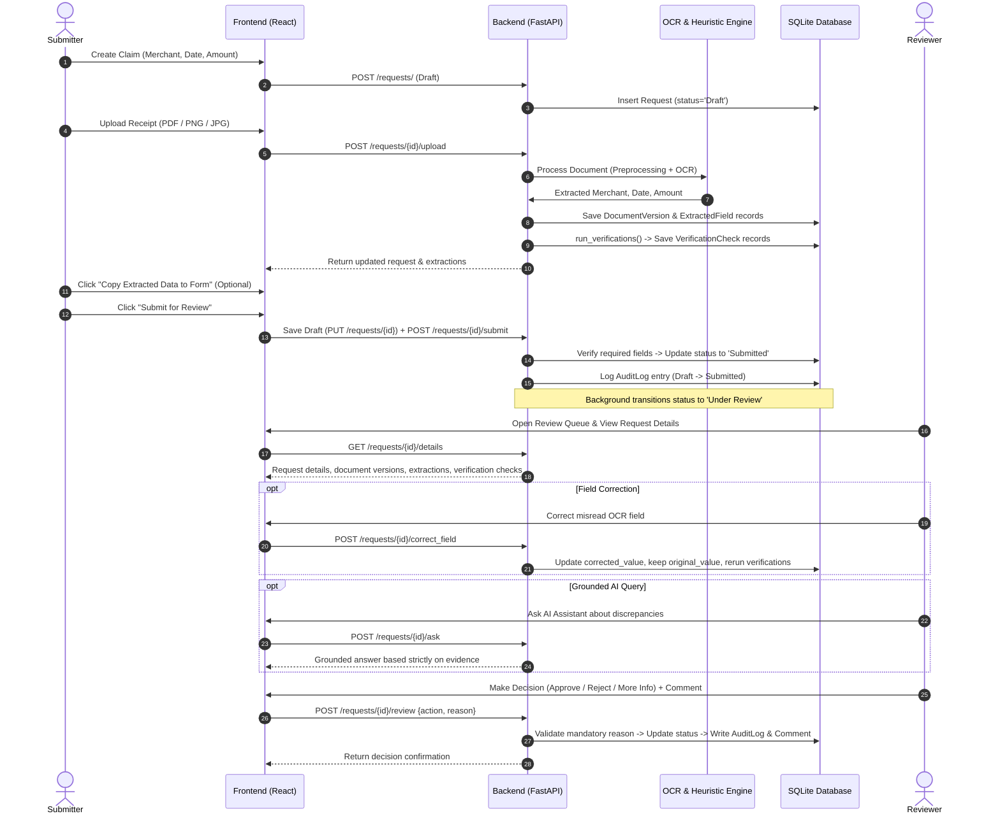

# Veriflow

### Intelligent Document Verification & Expense Reimbursement System

Veriflow is a full-stack, enterprise-grade expense reimbursement and automated document verification platform. It eliminates the manual review bottleneck in financial workflows by extracting structured receipt data, triangulating claimed amounts and dates against uploaded documents, enforcing corporate expense policies, tracking immutable document version history, and assisting reviewers with grounded AI suggestions.

---

## Table of Contents

1. [Overview & Problem Solved](#overview--problem-solved)
2. [Key Capabilities](#key-capabilities)
3. [Technology Stack](#technology-stack)
4. [System Architecture & Components](#system-architecture--components)
5. [End-to-End Workflow](#end-to-end-workflow)
6. [OCR & Document Processing Engine](#ocr--document-processing-engine)
7. [Verification Rules & State Machine](#verification-rules--state-machine)
8. [Authentication & Role-Based Access Control](#authentication--role-based-access-control)
9. [Database Schema & Version Traceability](#database-schema--version-traceability)
10. [AI Assistant & Offline Fallback](#ai-assistant--offline-fallback)
11. [Prerequisites & Environment Setup](#prerequisites--environment-setup)
12. [Running the Application](#running-the-application)
13. [Demo Accounts & Development Credentials](#demo-accounts--development-credentials)
14. [Automated Testing & Evaluation](#automated-testing--evaluation)
15. [Current Limitations & Future Improvements](#current-limitations--future-improvements)

---

## Overview & Problem Solved

Traditional expense reimbursement systems rely heavily on manual human verification. Finance teams manually transcribe receipts, cross-check line items against claim forms, and detect errors or policy violations. This leads to three major problems:
- **Review Fatigue & Fraud Slippage:** Manual reviewers miss subtle discrepancies (e.g., claiming \$1,250 for a \$125 receipt, claiming sales taxes or tips twice, or duplicate submissions).
- **Approval Latency:** Claims sit in review queues for days while reviewers decipher blurry smartphone photos, skewed scans, or foreign currency symbols.
- **The "Blind Automation" Trap:** Naive AI systems that attempt full end-to-end auto-approval without human oversight fail catastrophically when OCR models misread skewed text, read cashier IDs as merchant names, or confuse subtotal lines with grand totals.

**Veriflow solves this dilemma through an evidence-linked, human-in-the-loop verification architecture.** Rather than allowing AI to execute financial transactions autonomously, Veriflow employs local OCR and heuristic extraction to detect mathematical and policy deltas, presenting side-by-side evidence to human reviewers who make the final decision with full audit accountability.

---

## Key Capabilities

1. **Expense Claim Management**
   - Create reimbursement requests with merchant, date, amount, category, and description.
   - Comprehensive state machine tracking: `Draft`, `Submitted`, `Under Review`, `More Information Required`, `Approved`, `Rejected`, `Processing Failed`, and `Withdrawn`.
   - Pre-submission synchronization: draft changes are persisted and verified before status transitions.

2. **Immutable Document Upload & Version History**
   - Supports **PDF**, **PNG**, **JPG**, **JPEG**, **TIFF**, **BMP**, and **WEBP** formats (up to 10 MB).
   - Document replacement preserves prior versions in an immutable relational history (`DocumentVersion`), maintaining complete forensic audit trails.
   - Multi-document isolation: allows multiple receipts or invoices per claim, with per-document extraction views and a dedicated document switcher.

3. **Automated Dual-Engine OCR & Document Normalization**
   - Fast native digital PDF text extraction via `pdfplumber` (~36 ms latency).
   - High-accuracy image OCR with deep learning via `PaddleOCR` (PP-OCRv4) and automated fallback to `PyTesseract` (v5+ LSTM neural engine).
   - Image preprocessing pipeline: EXIF rotation correction, Lanczos resolution upscaling for low-DPI receipts, alpha-channel compositing over pure white, and adaptive contrast optimization.
   - Multi-tier regex heuristics handling subtotals, VAT/GST taxes, tips, cash tendered lines, and European comma decimals.

4. **Triangulation Verification Engine**
   - **Amount Consistency:** Verifies claim amount against document total within 1 cent.
   - **Date Consistency & Validity:** Matches receipt date against claim date and flags future dates.
   - **Merchant Consistency:** Normalizes legal entity suffixes (`Inc`, `LLC`, `Sdn Bhd`) and uses string similarity (`difflib`) to detect spelling typos.
   - **High-Value Policy Warning:** Flags claims exceeding \$5,000 for elevated reviewer approval without blocking submission.
   - **Duplicate Claim Detection:** Warns if another request shares the same date, amount, and merchant.
   - **Legibility & Corruption Guard:** Detects corrupted files or unreadable text, routing them to `Processing Failed` for triage.

5. **Human-in-the-Loop Review & Corrections**
   - **Side-by-Side Review:** Embedded live document preview directly adjacent to extracted fields and verification checks.
   - **Field Corrections:** Reviewers can edit misread OCR values while immutably preserving the original machine reading in the database.
   - **Explicit Decision Controls:** Dedicated action cards for **Approve Claim**, **Reject Claim**, and **Request More Information**.
   - **Mandatory Audit Reasons:** Server-side validation requires written justification for rejections and correction requests, logged permanently in `AuditLog`.
   - **Explicit Form Copy:** Submitters can copy extracted OCR values to the claim form with one click.

6. **Grounded AI Assistant (Google Gemini Integration)**
   - Powered by the modern `google-genai` SDK (`gemini-2.0-flash`).
   - Answers reviewer and submitter questions strictly using ground-truth database evidence.
   - Generates drafted correction messages when claims require more information.
   - **Deterministic Offline Fallback:** When `GEMINI_API_KEY` is not configured, the assistant provides rule-based offline analysis without crashing or hallucinating.

7. **Security & Cryptographic Authentication**
   - PBKDF2-HMAC-SHA256 salted password hashing (100,000 iterations + 16-byte cryptographically secure salts).
   - Strict server-side Role-Based Access Control (RBAC) preventing Submitters from approving their own claims.
   - Non-destructive database migrations preserving claims and user accounts.

8. **Responsive UI & Viewport Layout**
   - Zero-horizontal-scroll desktop tables using fixed layouts (`table-fixed`) and ellipsis truncation with hover tooltips for long merchant names.
   - Desktop sidebar pinned to viewport height (`sticky top-0 h-screen`) with Logout anchored at the bottom.
   - Full mobile responsive experience with compact card layouts and collapsible drawer navigation on screens under 768px.

---

## Technology Stack

| Layer | Technology | Version | Purpose in Veriflow |
|---|---|---|---|
| **Backend Framework** | FastAPI | `^0.110.0` | Asynchronous REST API routing, dependency injection, and OpenAPI documentation. |
| **ASGI Server** | Uvicorn | `^0.28.0` | Production-grade ASGI server handling asynchronous HTTP requests. |
| **ORM & Database** | SQLAlchemy | `^2.0.28` | Declarative relational database modeling, connection management, and SQLite dialect abstraction. |
| **Data Validation** | Pydantic | `^2.7.0` | Request payload validation, response schemas, and date input normalization. |
| **Cryptographic Security** | Python `hashlib` & `secrets` | Standard Library | PBKDF2-HMAC-SHA256 password hashing (100k rounds), constant-time verification (`compare_digest`). |
| **Native PDF Extraction** | pdfplumber | `^0.11.0` | High-speed text and layout extraction from digital vector PDFs (~36 ms). |
| **Image OCR (Primary)** | PyTesseract | `^0.3.10` | C++ bindings to Tesseract OCR v5+ LSTM neural network engine. |
| **Image OCR (Advanced)** | PaddleOCR | Optional | Lazy-load PP-OCRv4 English recognition and angle classification (auto-fallback to Tesseract on Python 3.14+). |
| **Image Preprocessing** | Pillow (PIL) | `^10.2.0` | EXIF rotation correction, Lanczos upscaling, alpha compositing, and adaptive autocontrast. |
| **AI / LLM Integration** | Google GenAI SDK | `^0.1.1` | Gemini 2.0 Flash integration for evidence-grounded review Q&A and correction drafts. |
| **Frontend Framework** | React | `^19.2.8` | Client-side reactive UI, state management, form drafting, and modal interactions. |
| **Frontend Tooling** | Vite | `^8.3.0` | High-speed build tooling and local development HMR server. |
| **CSS Architecture** | Tailwind CSS | `^4.3.3` | Utility-first styling, semantic color tokens, responsive breakpoints, and fixed table layouts. |
| **Iconography** | Lucide React | `^1.49.0` | Contextual vector icons for status badges, actions, and document formats. |
| **Test Automation** | Pytest | `^8.1.0` | Automated regression testing covering RBAC, OCR heuristics, and workflows (73 tests). |

---

## System Architecture & Components

```
+-----------------------------------------------------------------------------------+
|                               FRONTEND (React 19 + Vite)                          |
|  +--------------------+  +----------------------+  +---------------------------+  |
|  |     Login Page     |  | Dashboard & Metrics  |  |    Review Queue (RBAC)    |  |
|  | (PBKDF2 Masked UI) |  | (table-fixed / Cards)|  | (Desktop Table & Cards)   |  |
|  +--------------------+  +----------------------+  +---------------------------+  |
|  +-----------------------------------------------------------------------------+  |
|  |             Request Detail Page (Multi-Doc Switcher, Live Preview)          |  |
|  |      [Edit Form] <---> [Verification Badges] <---> [Make Decision Panel]    |  |
|  +-----------------------------------------------------------------------------+  |
+------------------------------------------+----------------------------------------+
                                           | HTTP / REST (Bearer Auth)
+------------------------------------------v----------------------------------------+
|                               FASTAPI BACKEND SERVER                              |
|  +---------------------+  +----------------------+  +--------------------------+  |
|  |   Auth & Security   |  |   Request Lifecycle  |  |   Reviewer Decision API  |  |
|  | (PBKDF2-HMAC-SHA256)|  | (Submit, Resubmit)   |  | (Mandatory Audit Reason) |  |
|  +---------------------+  +----------------------+  +--------------------------+  |
|  +-----------------------------------------------------------------------------+  |
|  |                        Verification Engine State Machine                    |  |
|  |  [Required Rules]  [Amount Delta]  [Date Check]  [Merchant Typo]  [Duplicate] |  |
|  +-----------------------------------------------------------------------------+  |
|  +-----------------------------------------------------------------------------+  |
|  |                    Document Processing & OCR Pipeline                       |  |
|  |  Format Router -> Preprocessing (Lanczos/Contrast) -> OCR Engine -> Heuristics|  |
|  +-----------------------------------------------------------------------------+  |
+------------------------------------+------------------+---------------------------+
                                     |                  |
           +-------------------------v---+          +---v------------------------+
           |       SQLite Database       |          |      Local File System     |
           |  users, requests, documents |          |          uploads/          |
           |  document_versions, fields  |          | (Immutable version storage)|
           |  verification_checks, audit |          +----------------------------+
           +-----------------------------+
```

### Component Responsibilities

1. **Frontend (`frontend/src/`):** Manages user authentication state, reactive form editing, real-time client validation, live document previewing, multi-document tab switching, and responsive layouts across desktop, tablet, and mobile displays.
2. **FastAPI Gateway (`backend/main.py`):** Enforces authentication via Bearer tokens, validates role permissions server-side, routes CRUD actions, logs immutable audit trail entries, and calculates dashboard analytics.
3. **Security Module (`backend/security.py`):** Handles PBKDF2-HMAC-SHA256 password hashing, salt generation, and constant-time password verification.
4. **Document Processing Pipeline (`backend/ocr.py`):** Identifies file formats, routes native PDFs vs. scanned documents, applies Pillow image preprocessing, executes OCR (PaddleOCR / PyTesseract), and parses candidate lines for merchant, date, and amount.
5. **Verification Engine (`backend/main.py:run_verifications`):** Clears previous checks, iterates through active documents and claim details, calculates deltas, evaluates high-value thresholds and duplicate checks, and commits verification check records.
6. **AI Assistant (`backend/llm.py`):** Ingests structured request context (claim values, extractions, verification checks) and queries Gemini 2.0 Flash to answer user questions with strict grounding, or provides deterministic offline analysis.

---

## End-to-End Workflow



---

## OCR & Document Processing Engine

```
[ Uploaded Document ]
        |
        v
+-------------------+
|  Extension Check  |
+---------+---------+
          |
   +------+------+
   |             |
   v (.pdf)      v (.png, .jpg, .jpeg, .tiff, .bmp, .webp)
+-----------+  +------------------------------------------------+
| pdfplumber|  |           Pillow Image Preprocessing           |
+-----+-----+  | 1. ImageOps.exif_transpose() (Fix Orientation) |
      |        | 2. Composite alpha/transparency over white RGB |
   Text Found? | 3. Lanczos upscaling if width < 1000px         |
     /    \    | 4. ImageOps.autocontrast() + 1.4x Contrast     |
   Yes     No  +-----------------------+------------------------+
   /        \                          |
  v          v                         v
Native     Scanned Page        +---------------+
Text       Rendered (200 DPI)  | Dual OCR Flow |
  |          \                 +-------+-------+
  |           +-------------------> /     \
  |                                v       v
  |                      PaddleOCR (DL)  PyTesseract (LSTM)
  +--------------------------------+-------+
                                   |
                                   v
                      +-------------------------+
                      |   Extracted Text Lines  |
                      +------------+------------+
                                   |
    +------------------------------+-----------------------------+
    |                              |                             |
    v                              v                             v
[ Merchant Selection ]    [ Date Normalization ]      [ Amount Hierarchy ]
Candidate scoring:        20 date pattern formats:    Tier 1: Explicit Grand Total
- Business indicators (+30) Day-first parsing prioritized Tier 2: Total keywords
- Noise exclusions (-50)  Sanity range: 1990 to +1 yr Tier 3: Max candidate fallback
- Staff patterns (-40)    Standardized to YYYY-MM-DD  European comma handling
```

### Technical Implementation References
* **Path Resolution (`find_tesseract_cmd`):** Discovers Tesseract binaries across custom `TESSERACT_CMD` environment variables, system PATH, and 6 standard Windows directories (Program Files, Local AppData, Scoop).
* **Image Preprocessing (`preprocess_receipt_image`):** Automatically normalizes orientation, flattens alpha channels, upscales low-DPI receipts, and boosts contrast.
* **Dual Engine Routing (`_ocr_image`):** Queries `get_paddle_ocr()` singleton; if unavailable or running on Python 3.14+, seamlessly falls back to PyTesseract.
* **Scanned vs. Native Detection (`_read_text`):** Leverages `pdfplumber` to extract digital text instantly. If zero text is returned, converts pages to 200 DPI bitmaps and invokes the OCR pipeline.

---

## Verification Rules & State Machine

The verification engine (`backend/main.py:run_verifications`) runs on claim creation, document upload, field correction, and claim editing. It evaluates rules and records discrete entries in the `VerificationCheck` table:

| Rule Name | Checked Conditions | Result Categories | Result Status |
|---|---|---|---|
| **Required Document** | Verifies at least 1 document is attached to the claim. | `valid`, `missing` | `PASS` or `CANNOT DETERMINE` |
| **Required Field** | Verifies `merchant_name`, `expense_date`, and `expense_amount` are provided. | `valid`, `missing` | `PASS` or `CANNOT DETERMINE` |
| **Document Readability** | Checks if any attached document failed OCR extraction. | `valid`, `unreadable` | `PASS` or `CANNOT DETERMINE` |
| **Amount Consistency** | Compares form amount against extracted document total within \$0.01. | `valid`, `inconsistent`, `unreadable` | `PASS`, `INCONSISTENT`, or `CANNOT DETERMINE` |
| **High Value Policy** | Triggers when claim amount exceeds \$5,000 threshold. | `unusual_amount` | `WARNING` |
| **Date Consistency** | Compares form date against extracted document date. | `valid`, `inconsistent`, `unreadable` | `PASS`, `INCONSISTENT`, or `CANNOT DETERMINE` |
| **Date Validity** | Checks if the extracted receipt date is in the future. | `inconsistent` | `WARNING` |
| **Merchant Consistency** | Normalizes business suffixes (`Inc`, `LLC`, `Sdn Bhd`) and compares names. | `valid`, `spelling_mismatch`, `inconsistent` | `PASS`, `WARNING` (if `difflib` similarity >= 65%), or `INCONSISTENT` |
| **Possible Duplicate** | Searches for other requests sharing the same date, amount, and merchant. | `duplicate` | `WARNING` |

---

## Authentication & Role-Based Access Control

### PBKDF2-HMAC-SHA256 Implementation (`backend/security.py`)
* **Algorithm:** Password-Based Key Derivation Function 2 using HMAC with SHA-256.
* **Iterations:** 100,000 rounds.
* **Salt:** Cryptographically random 16-byte hex salt per user (`secrets.token_hex(16)`).
* **Storage Format:** `pbkdf2_sha256$<salt>$<key_hex>`.
* **Timing-Attack Resistance:** Verified via constant-time string comparison (`secrets.compare_digest`).

### Role Permissions Matrix

| Capability | Submitter | Reviewer | Approver |
|---|:---:|:---:|:---:|
| Create draft claims & upload receipts | Yes | No | No |
| Edit & resubmit returned claims | Yes | No | No |
| Withdraw pending claims | Yes | No | No |
| Copy extracted OCR data to claim form | Yes | Yes | Yes |
| Inspect Review Queue & all claims | No | Yes | Yes |
| Perform OCR field corrections | No | Yes | Yes |
| Trigger OCR re-processing | No | Yes | Yes |
| Request more information with reason | No | Yes | Yes |
| Approve claims | No | Yes | Yes |
| Reject claims with reason | No | Yes | Yes |
| Self-approve own claims | **Blocked** | **Blocked** | **Blocked** |
| Query AI Assistant | Own claims only | All claims | All claims |

---

## Database Schema & Version Traceability

Veriflow maintains complete relational traceability across all objects:

```
[ User ]
   | (1:N)
   +-------------------------------------------------------+
   |                                                       |
   v                                                       v
[ Request ] <---+                                     [ AuditLog ]
   | (1:N)      | (1:N)                               (actor, from_status,
   |            +------------------+                   to_status, reason,
   |                               |                   timestamp)
   v                               v
[ Document ]              [ VerificationCheck ]
   | (1:N)                (rule_name, evidence,
   v                       result, category,
[ DocumentVersion ]        timestamp)
   | (1:N)
   v
[ ExtractionRun ] (engine, status, started_at, error_message)
   | (1:N)
   v
[ ExtractedField ] (field_name, original_value, corrected_value,
                    corrected_by_user_id, corrected_at, confidence)
```

* **Immutable Document History:** Uploading a revised receipt creates a new `DocumentVersion` row (`version_number` = 2) linked to the existing `Document`. Prior versions, files, and extraction runs are never overwritten.
* **Original vs. Corrected Fields:** When a reviewer edits an OCR value, `original_value` is retained and `corrected_value`, `corrected_by_user_id`, and `corrected_at` are populated, providing complete audit accountability.

---

## AI Assistant & Offline Fallback

The AI Assistant (`backend/llm.py`) is designed as a focused document verification aid:
1. **Grounded Answering:** When a user asks a question, the backend packages the claim details, attached documents, OCR extractions, and verification checks into a structured evidence prompt.
2. **Safety Constraints:** System instructions strictly forbid the LLM from approving or rejecting claims, fabricating evidence, or honoring prompt injection attempts found in receipts.
3. **Deterministic Offline Fallback:** If `GEMINI_API_KEY` is not configured, the assistant provides a comprehensive, deterministic rule-based analysis detailing claim discrepancies, missing fields, and recommended next steps without crashing.

---

## Prerequisites & Environment Setup

### Prerequisites
* **Operating System:** Windows 10/11, macOS, or Linux.
* **Python:** Python 3.11, 3.12, 3.13, or 3.14 (Note: Python 3.14 natively uses Tesseract OCR; PaddleOCR runs on Python 3.10–3.13).
* **Node.js:** Node.js 18+ (with npm).
* **Tesseract OCR (Optional but recommended):** For image OCR. Download for Windows: [UB-Mannheim Tesseract Releases](https://github.com/UB-Mannheim/tesseract/wiki).

### Environment Variables
Configure environment variables in your terminal or system environment:

| Variable | Description | Default |
|---|---|---|
| `GEMINI_API_KEY` | *(Optional)* Google Gemini API key for online AI assistance. | Unset (uses deterministic offline analysis) |
| `TESSERACT_CMD` | *(Optional)* Absolute path to the Tesseract executable if not in system PATH. | Auto-detected across common paths |
| `DEMO_PASSWORD` | *(Optional)* Development password for seeded demo accounts. | `12345` |
| `ENVIRONMENT` | *(Optional)* Execution environment (`development` or `production`). | `development` |

> [!IMPORTANT]
> **Security Warning:** Never commit `.env` files, API keys, or database credentials to GitHub. Veriflow reads secrets exclusively from system environment variables.

---

## Running the Application

### 1. Backend Startup (FastAPI)

Open a Windows PowerShell terminal from the project root:

```powershell
# Optional: Set your Gemini API key
$env:GEMINI_API_KEY="your_api_key_here"

# Start the FastAPI backend
python -m uvicorn backend.main:app --host 127.0.0.1 --port 8000
```

* **Backend Base URL:** `http://127.0.0.1:8000`
* **Interactive OpenAPI (Swagger) Documentation:** `http://127.0.0.1:8000/docs`
* **Alternative ReDoc Documentation:** `http://127.0.0.1:8000/redoc`

### 2. Frontend Startup (React + Vite)

Open a second Windows PowerShell terminal from the project root:

```powershell
cd frontend
npm install
npm run dev
```

* **Frontend Web Application:** `http://localhost:5173` (or `http://localhost:5174` if port 5173 is occupied)
* The backend CORS configuration automatically accepts connections from both port 5173 and port 5174.

### 3. Frontend Production Build Verification
To verify the production bundle:
```powershell
cd frontend
npm run build
```

---

## Demo Accounts & Development Credentials

The local database comes pre-seeded with test accounts across all roles. 

> [!NOTE]
> All demo accounts use the standard local development password: **`12345`**.

| Username | Role | Primary Workflow Scenario |
|---|---|---|
| `alice_sub` | Submitter | Standard employee submitting travel & meal receipts |
| `bob_sub` | Submitter | Submitting hardware receipts & duplicate tests |
| `charlie_rev` | Reviewer | Document inspection, field corrections, requesting more info |
| `david_rev` | Reviewer | Reviewing high-value claims & policy warnings |
| `eve_app` | Approver | Final financial approvals & policy enforcement |
| `frank_app` | Approver | Final claim rejections with required audit notes |

---

## Automated Testing & Evaluation

### 1. Backend Regression Suite (73 Tests)
Veriflow includes **73 automated pytest tests** covering authentication, OCR heuristics, workflow state transitions, and reviewer decisions:

```powershell
python -m pytest backend/tests/ -v
```

#### Test Suite Inventory
* `backend/tests/test_auth_password.py`: 8 tests validating password authentication, wrong passwords, role mismatches, hash security, and RBAC actions.
* `backend/tests/test_auto_ocr_and_verification.py`: 8 tests validating native PDF extraction, image OCR, amount mismatches, unreadable detection, corrupt files, and AI grounding.
* `backend/tests/test_claim_submission_workflow.py`: 1 test verifying end-to-end draft save, validation, and submission refresh.
* `backend/tests/test_main.py`: 21 tests verifying CRUD, self-approval prevention, document versioning, filters, and audit logs.
* `backend/tests/test_ocr_heuristics.py`: 7 tests validating extraction heuristics against ground-truth benchmarks, date parsing, and amount extraction.
* `backend/tests/test_request_45_workflow.py`: 1 test verifying multi-document extraction isolation and document switching.
* `backend/tests/test_reviewer_decision_workflow.py`: 6 tests verifying approval comments, mandatory rejection reasons, mandatory more-info notes, and authorization.
* `backend/tests/test_traceability.py`: 2 tests verifying full relational database integrity across requests, documents, runs, fields, and checks.
* `backend/tests/test_verification.py`: 6 tests validating consistency checks, future date warnings, and duplicate detection.

### 2. End-to-End Lifecycle Verification Script
Runs a complete multi-actor simulated lifecycle from Submitter upload through Reviewer correction to Approver authorization:
```powershell
python verify_workflow.py
```

### 3. Repeatable OCR Benchmark Evaluation
Evaluates extraction accuracy against 9 representative real-world receipt edge cases:
```powershell
python eval/repeatable_evaluation.py
```
* **Benchmark Results:** 100% extraction accuracy on preprocessed receipts; 100% issue detection recall; ~393 ms average latency.

---

## Current Limitations & Future Improvements

### Current Limitations
1. **Physical Receipt Degradation:** Receipts with extreme physical thermal fading, water damage, or severe paper creases can drop characters in OCR, requiring reviewer manual correction.
2. **Multi-Currency Conversion:** While foreign currency symbols (`€`, `£`, `RM`) are parsed, claims currently assume a unified currency base without automatic live FX exchange conversion.
3. **Local SQLite Concurrency:** SQLite is optimal for single-node local development and testing; heavy concurrent enterprise production would benefit from PostgreSQL.

### Future Roadmap
1. **JWT Authentication:** Upgrade bearer tokens to signed JSON Web Tokens (JWT) with cryptographic expiration (`exp`) and refresh token rotation.
2. **Multi-Currency FX Converter:** Integrate live exchange-rate APIs to automatically convert foreign receipts to company base currency.
3. **Line-Item Breakdown Extraction:** Expand heuristic parsing to extract individual line-item tables in addition to the grand total.
4. **PostgreSQL Migration:** Transition database configurations to PostgreSQL with Alembic migration scripts for multi-region deployments.

---

## License

This project is licensed under the MIT License — see the LICENSE file for details.
